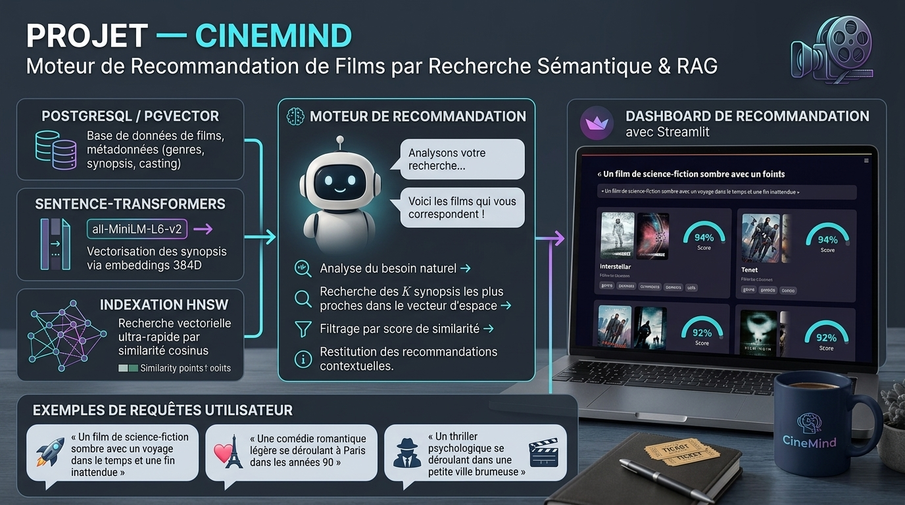

# CineMind — Moteur de Recommandation de Films par Recherche Vectorielle (RAG)



CineMind est une application web interactive qui permet de recommander des films en fonction de requêtes en langage naturel (ex: *"un film de science-fiction sombre avec une fin inattendue"*). 

Le projet s'appuie sur une approche RAG (Retrieval-Augmented Generation) combinant **PostgreSQL + pgvector** pour la recherche de similarité vectorielle et **Streamlit** pour la présentation graphique.

---

## Architecture globale et workflow CI/CD 

```mermaid
flowchart LR
    %% Styles avec texte noir et gras
    classDef dev fill:#e1f5fe,stroke:#0288d1,stroke-width:2px,color:#000000,font-weight:bold;
    classDef cicd fill:#fff3e0,stroke:#f57c00,stroke-width:2px,color:#000000,font-weight:bold;
    classDef cloud fill:#e8f5e9,stroke:#388e3c,stroke-width:2px,color:#000000,font-weight:bold;

    subgraph DEV["<b>💻 Environnement de Développement</b>"]
        Code["<b>Code Source</b><br/>(Python, Streamlit)"]
        DockerDev["<b>Gestion des dépendances</b><br/>(uv)"]
    end

    subgraph CICD["<b>⚙️ Intégration & Déploiement Continu (CI/CD)</b>"]
        Git["<b>Gestion de Version</b><br/>(GitHub)"]
        Pipeline["<b>Pipeline & Sécurité</b><br/>(GitHub Actions, Gitleaks, Bandit, Trivy)"]
        Registry["<b>Registre d'images</b><br/>(GitHub Container Registry - GHCR)"]
    end

    subgraph CLOUD["<b>☁️ Infrastructure Cloud (VM Hetzner)</b>"]
        App["<b>Service Applicatif</b><br/>(Docker Container Streamlit)"]
        BDD[("<b>Base de Données partagée</b><br/>(PostgreSQL, pgvector)")]
    end

    Code --> DockerDev
    DockerDev -->|Push Code| Git
    Git --> Pipeline
    Pipeline -->|Build & Push| Registry
    Registry -->|Docker Pull / Deploy| App
    App <--> BDD

    class DEV dev;
    class CICD cicd;
    class CLOUD cloud;
```



Vue d'ensemble de l'architecture : pipeline CI/CD sécurisé sur GitHub Actions, stockage de l'image sur le registre GHCR, et déploiement automatisé sur une VM Hetzner connectée à une base de données PostgreSQL/pgvector mutualisée.

## Structure du Dépôt

```text
├── .github/workflows
│   └── ci-cd.yml
├── app.py
├── data
│   └── sample_movies.csv
├── Dockerfile
├── pyproject.toml
├── README.md
├── scripts
│   ├── extract_tmdb.py
│   ├── ingest_and_embed.py
│   └── ...
└── uv.lock
```

## Spécifications Techniques

- Base de données : PostgreSQL avec l'extension pgvector.

- Modèle d'embedding : Sentence-Transformers (all-MiniLM-L6-v2) — Vecteurs de 384 dimensions.

- Indexation : Indexation HNSW (vector_cosine_ops) pour optimiser la recherche par distance cosinus.

- Gestionnaire de paquets : uv pour des installations ultra-rapides.

- Interface : Streamlit.

- CI/CD : GitHub Actions (Gitleaks, Bandit, Trivy, Build GHCR, Déploiement SSH).

## Guide de Déploiement / Reproduire le Projet
Suivre ces étapes pour installer et exécuter CineMind sur son propre environnement.

1. Déploiement local

```bash
# Cloner le dépôt
git clone [https://github.com/johnplt/cinemind.git](https://github.com/johnplt/cinemind.git)
cd cinemind

# Synchroniser les dépendances
uv sync --all-extras --dev
```

2. Pipeline CI/CD (GitHub Actions)
Le projet dispose d'un pipeline unifié (.github/workflows/ci-cd.yml) qui s'exécute automatiquement à chaque push sur la branche main :

1. CI (Tests & Sécurité) :

    - Scan des secrets (Gitleaks).Licence
Projet sous licence MIT. Libre réutilisation et modification.

    - Installation et synchronisation des dépendances avec uv.

    - Vérification de la syntaxe Python et scan des vulnérabilités de code (Bandit, Trivy).

2. CD (Build & Déploiement) :

    - Construction de l'image Docker et envoi sécurisé sur le GitHub Container Registry (GHCR).

    - Connexion SSH automatisée à la VM de production (Hetzner) pour récupérer la nouvelle image (docker pull) et redémarrer le conteneur proprement sans interruption majeure.

## Licence
Projet sous licence MIT. Libre réutilisation et modification.